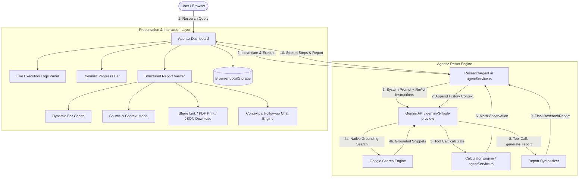
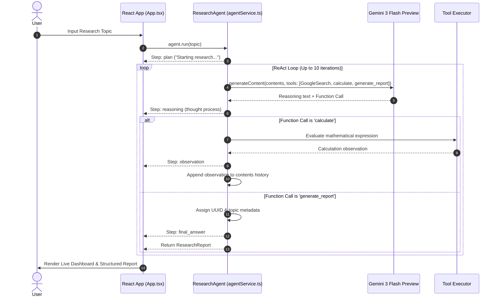

# Research & Report Agent — Codebase Architecture & Technical Specification

> **Version**: 1.0.0  
> **Core Model**: Google Gemini (`gemini-3-flash-preview` via `@google/genai` SDK)  
> **Frontend Stack**: React 19, TypeScript 5.8, Tailwind CSS v4, Motion (Framer Motion v12), Recharts, Lucide Icons, Vite 6  
> **Architectural Pattern**: Serverless Client-Side ReAct (Reasoning + Acting) Agent

---

## 1. Executive Summary & System Purpose

The **Research & Report Agent** is an autonomous agentic application that demonstrates the core pillars of modern AI agents:
1. **Understands a Goal**: Decomposes high-level natural language user queries into structured research directives.
2. **Plans Steps & Multi-Step Reasoning**: Executes an iterative **ReAct** (Reason + Act + Observe) cycle up to 10 iterations.
3. **Utilizes Tools Dynamically**: Leverages live Google Search grounding, an on-demand mathematical calculation engine, and a structured report synthesizer.
4. **Produces Structured Artifacts & Visualizations**: Compiles deep research into executive summaries, detailed markdown sections, interactive Recharts visualizations, verified source citations, and mathematical proofs.
5. **Observability & Interaction**: Features real-time step streaming (reasoning, tool calls, observations, plans), contextual follow-up chat, local persistence, shareable deep-links, and print/PDF/JSON exports.

---

## 2. System Architecture & Component Hierarchy

### 2.1 High-Level Architecture Diagram



---

## 3. Directory & File Breakdown

```
Research-&-Report-Agent/
├── .antigravity/                   # Project metadata and session checkpoint history
├── .vscode/                        # IDE debug configurations and settings
├── dist/                           # Production build assets (compiled by Vite)
├── src/
│   ├── lib/
│   │   └── utils.ts                # Class merging utility (clsx + tailwind-merge)
│   ├── services/
│   │   └── agentService.ts         # Agent engine, tool declarations, ReAct loop, Q&A service
│   ├── App.tsx                     # Main application UI, state management, dashboard, & project documentation
│   ├── index.css                   # Global styles & Tailwind CSS v4 entry point
│   ├── main.tsx                    # React 19 entry point and StrictMode root mounting
│   └── types.ts                    # TypeScript interface definitions (AgentStep, ResearchReport)
├── .env.example                    # Environment variable template
├── .env                            # Injected Gemini API credentials
├── index.html                      # HTML5 host document
├── metadata.json                   # Application metadata descriptor
├── package.json                    # Project dependencies, scripts, and runtime engines
├── tsconfig.json                   # TypeScript compiler options
└── vite.config.ts                  # Vite build tool and environment configuration
```

---

## 4. In-Depth Component Analysis

### 4.1 Agent Engine (`src/services/agentService.ts`)

The agent core encapsulates the autonomous behavior of the system.

#### Tools Specification
- **`calculatorTool` (`calculate`)**:
  - **Purpose**: Eliminates LLM arithmetic hallucination by offloading quantitative calculations to a deterministic math evaluator.
  - **Input Schema**: `{ expression: string }`
  - **Execution**: Evaluates sanitized mathematical expressions and returns observation strings directly into conversational context.
- **`reportTool` (`generate_report`)**:
  - **Purpose**: Enforces strict structured output formatting for the final synthesized intelligence document.
  - **Schema Fields**:
    - `title`: String
    - `summary`: String (executive overview)
    - `sections`: Array of `{ heading: string, content: string }`
    - `sources`: Array of `{ title: string, url: string, snippet: string }`
    - `calculations`: Array of strings
    - `chartData`: Array of `{ title: string, data: [{ name: string, value: number }] }`
- **Native Google Search (`{ googleSearch: {} }`)**:
  - Native Gemini web search grounding tool providing live, factual internet knowledge.

#### The ReAct Execution Cycle


#### Follow-up Contextual Chat (`askFollowUp`)
- Accepts the full `ResearchReport` object, chat history, and the user's inquiry.
- Binds the generated report data directly into the LLM system instruction context (`Title`, `Summary`, `Sections`, `Calculations`), preventing hallucinations and keeping answers grounded exclusively in the researched document.

---

### 4.2 Presentation & Interaction Layer (`src/App.tsx`)

`App.tsx` handles the user experience with responsive state management and visual styling.

#### Key Features & Subsystems:
1. **Two Major Tabs**:
   - **Dashboard**: The primary operational workbench containing the research goal input, progress tracker, real-time log inspector, generated report viewer, chart renderer, source inspector, and contextual chat.
   - **Project Details**: Interactive academic documentation covering Part A (Agent Design) and Part C (Classical vs. Modern Agent Comparison).
2. **Real-time Observability**:
   - Live step indicator rendering differentiated badge styles and icons for `reasoning` (BrainCircuit/Purple), `tool_call` (Calculator/Blue), `observation` (Search/Green), `plan` (History/Orange), and `final_answer` (CheckCircle2/Emerald).
   - Expandable JSON viewer for tool arguments.
   - Dynamic progress bar tracking task completion status from 0% to 100%.
3. **Data Visualization (`Recharts`)**:
   - Dynamically parses the agent's structured `chartData` and renders responsive `BarChart` components with customizable dark/light tooltips and cartesian grids.
4. **Source Verification Modal**:
   - Clicking any citation in the Sources & References section triggers an animated modal displaying the source title, sanitized link, context snippet extracted during research, and external navigation button.
5. **Persistence & Search History**:
   - Sliding history drawer backed by browser `localStorage`.
   - Allows users to re-mount historical research reports, delete unwanted reports, or inspect past topics without re-triggering API quotas.
6. **Report Sharing & Export Engine**:
   - **Copy Link**: Automatically packages the active report ID into URL query parameters (`?reportId=...`). On initial page load, the app automatically checks URL parameters and reconstructs the shared report from local storage.
   - **Save as PDF**: Invokes print engine alongside print-tailored CSS media queries (`print:hidden`, `print:prose-slate`, `print:break-inside-avoid`, clean white background and removal of sidebars/controls).
   - **Download JSON**: Generates client-side Blob downloadable formatted JSON files.
7. **Theming**:
   - Seamless dark mode / light mode toggle adhering to system preferences and saved in `localStorage`.

---

## 5. Specifications & Compliance Matrix

Below is the verification of the codebase against the project specification requirements:

| Requirement Category | Specific Requirement | Implementation Status | Implementation Details in Codebase |
| :--- | :--- | :---: | :--- |
| **Pillar 1: Understands Goal** | User inputs high-level research topic | **COMPLIANT** | Input field in `App.tsx` (lines 464-472) bound to `handleStartResearch`. |
| **Pillar 2: Plans Steps** | Agent breaks topic into sub-tasks / planning | **COMPLIANT** | Initial `plan` step emitted (line 103, `agentService.ts`), system prompt enforces step-by-step breakdown. |
| **Pillar 3: Uses Tools** | At least two tools (Search + Calculator + Document output) | **COMPLIANT** | 3 tools integrated: Native Google Search grounding, `calculate` math engine, and `generate_report` structured serializer. |
| **Pillar 4: Produces Output** | Structured research report artifact | **COMPLIANT** | Structured `ResearchReport` containing title, summary, markdown sections, sources, calculations, and chartData. |
| **Part A: Agent Design** | Goal of the Agent explained | **COMPLIANT** | Interactive card under "Project Details" tab in `App.tsx` (lines 832-840). |
| **Part A: Agent Design** | Agent Role explained | **COMPLIANT** | Documented under "Goal & Role" in `App.tsx` (lines 837-839). |
| **Part A: Agent Design** | Tools Used detailed | **COMPLIANT** | Documented under "Tools Used" in `App.tsx` (lines 860-869). |
| **Part A: Agent Design** | Memory Type explained | **COMPLIANT** | Contextual/Short-term memory documented in `App.tsx` (lines 852-858). |
| **Part A: Agent Design** | Planning Strategy (ReAct) explained | **COMPLIANT** | ReAct strategy documented in `App.tsx` (lines 842-849). |
| **Part B: Implementation** | One LLM-based agent | **COMPLIANT** | `ResearchAgent` powered by `gemini-3-flash-preview` via `@google/genai`. |
| **Part B: Implementation** | At least two functional tools | **COMPLIANT** | 3 tools: `googleSearch`, `calculate`, `generate_report`. |
| **Part B: Implementation** | Multi-step reasoning | **COMPLIANT** | ReAct while-loop up to 10 iterations with back-and-forth tool evaluation. |
| **Part B: Implementation** | Observable agent behavior (logs/traces) | **COMPLIANT** | Real-time step callback stream rendering color-coded logs in the UI dashboard. |
| **Part C: Comparison** | Classical vs. Modern Agent Comparison Table | **COMPLIANT** | Comprehensive comparison table in `App.tsx` (lines 881-912) comparing Logic, Planning, Memory, and Reasoning. |
| **Deliverable: Export** | PDF / Print Export | **COMPLIANT** | Print CSS styling (`print:` utility classes) + Export Dropdown "Save as PDF" triggering `window.print()`. |
| **Deliverable: Export** | JSON Data Download | **COMPLIANT** | "Download JSON" export option producing formatted `.json` files. |
| **Deliverable: Diagrams** | Architecture & Tool Flow Diagrams | **COMPLIANT** | Visualized in application documentation and embedded in this architecture specification. |
| **Deliverable: Interaction Logs**| Real-time and persistent interaction tracking | **COMPLIANT** | Timestamped live execution log list with tool argument inspector and history drawer. |

---

## 6. Data Models & TypeScript Contracts

### 6.1 `AgentStep`
```typescript
export interface AgentStep {
  id: string;
  type: 'reasoning' | 'tool_call' | 'observation' | 'plan' | 'final_answer';
  content: string;
  timestamp: number;
  toolName?: string;
  toolArgs?: any;
}
```

### 6.2 `ResearchReport`
```typescript
export interface ResearchReport {
  id?: string;
  topic?: string;
  title: string;
  summary: string;
  sections: {
    heading: string;
    content: string;
  }[];
  sources: ({ title: string; url: string; snippet?: string } | string)[];
  calculations?: string[];
  chartData?: {
    title: string;
    data: { name: string; value: number }[];
  }[];
}
```

---

## 7. Security, Resilience, & Technical Considerations

1. **API Key Security**: The Gemini API key is loaded via Vite's `loadEnv` during build/runtime and accessed via `process.env.GEMINI_API_KEY`.
2. **Mathematical Evaluation Safety**: The `calculate` tool uses regex sanitization (`expression.replace(/[^-()\d/*+.]/g, '')`) before evaluation to guard against arbitrary script injection.
3. **Loop Bound Safety**: The ReAct execution loop is strictly bounded by `maxIterations = 10` to prevent infinite execution loops and uncontrolled API token consumption.
4. **Graceful Fallbacks**: If the model finishes generating thoughts without invoking the report generator tool, the loop proactively injects a corrective user reminder: `"Please use the 'generate_report' tool to provide the final structured output."`

---

## 8. Development & Build Verification

- **Linting & Type-checking**: Passes TypeScript 5.8 check (`npm run lint` / `tsc --noEmit`).
- **Production Build**: Successfully compiles via `vite build` into `dist/`.
- **Development Server**: Configured for local and network access via `vite --port=3000 --host=0.0.0.0`.
