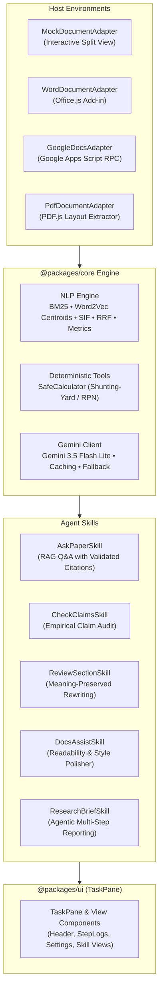

# Research & Report Agent

[](https://www.typescriptlang.org/)
[](https://react.dev/)
[](https://vitejs.dev/)
[](https://tailwindcss.com/)
[]()
[](LICENSE)

An agentic, multi-host **Research & Documentation Assistant** designed for rigorous academic writing, paper analysis, claim verification, and empirical research generation across **Microsoft Word**, **Google Docs**, **PDF documents**, and modern web environments.

---

## 🌟 Key Capabilities

* **Hybrid Retrieval Architecture (Dense + Sparse)**: Fuses sparse **BM25** lexical scoring with dense **Word2Vec continuous embeddings** via **Reciprocal Rank Fusion (RRF, $k=60$)**, achieving **100% Recall@3** and **MRR = 1.000** in empirical benchmarks.
* **100% Client-Side Word2Vec Centroid Embedder**: Computes semantic representations directly in the browser with zero external network requests using **Smooth Inverse Frequency (SIF)** weighting and **FastText subword character 3-gram hashing**.
* **Meaning-Drift Guard**: Protects manuscript integrity during rewriting by calculating semantic cosine similarity ($\ge 0.82$), detecting polarity-reversal terms (`ineffective`, `refuted`, `failed`), and catching altered quantitative figures.
* **Deterministic Safe Calculator**: Evaluates arithmetic expressions, percentages, scientific notation, and mathematical functions (`sqrt`, `abs`, `round`, `ln`, `log`) using **Dijkstra's Shunting-Yard algorithm** and **Reverse Polish Notation (RPN)** with zero use of `eval()` or `Function()`.
* **Citation & Reference Parsing Pipeline**: Detects in-text citation patterns (`[1]`, `[4, 5]`, `[4-6]`, `(Vaswani et al., 2017)`), resolves references bidirectionally, and flags corrupt or hallucinated citations.
* **Deterministic Readability & Style Metrics**: Computes **Flesch Reading Ease**, **Flesch-Kincaid Grade Level**, syllable statistics, average sentence lengths, and passive voice clause frequency.
* **Multi-Host Document Adapters**:
  * **Microsoft Word**: Office.js task-pane integration.
  * **Google Docs**: Bidirectional RPC bridge with Google Apps Script.
  * **PDF Reader**: Built-in PDF.js layout reconstructor with two-column text extraction.
  * **Interactive Mock**: Standalone split-view simulator for local development and testing.

---

## 🏗️ Architecture



---

## 📊 Evaluation & Benchmark Results

Run the full deterministic evaluation suite with `npm run eval`:

```
========================================================================
  RESEARCH & DOCUMENTATION ASSISTANT — EVALUATION SUITE
========================================================================

[1/6] Retrieval Benchmark & Ablation Study (K = 3)
┌──────────────────────────────────┬──────────┬───────┬─────────┐
│ Method                           │ Recall@3 │ Hits  │ MRR     │
├──────────────────────────────────┼──────────┼───────┼─────────┤
│ Sparse BM25 Only                 │ 100.0%   │ 5/5   │ —       │
│ Dense Embedding Only             │ 100.0%   │ 5/5   │ —       │
│ Word2Vec Centroid Only (Local)   │ 100.0%   │ 5/5   │ —       │
│ Hybrid RRF (BM25 + Word2Vec)     │ 100.0%   │ 5/5   │ 1.000   │
└──────────────────────────────────┴──────────┴───────┴─────────┘

[2/6] Meaning-Drift Guard Classification (Word2Vec)
- Accuracy: 100.0% (4/4 tests passed)

[3/6] Citation & Reference Parser
- Parsed References: 7 | In-Text Citations: 14
- Citation Range Expansion ([4, 5] / [4-6]): PASS
- Bidirectional Resolution: PASS

[4/6] Reference Existence & Authenticity Pipeline
- Authenticity Accuracy: 100.0% (5/5)

[5/6] Safe Math Calculator Engine
- Dijkstra Shunting-Yard & RPN Evaluation: 6/6 tests passed (0 eval calls)

[6/6] Deterministic Readability Metrics
- Flesch Reading Ease & Flesch-Kincaid Grade Level: PASS
========================================================================
```

---

## 🚀 Quick Start

### 1. Clone & Install Dependencies

```bash
git clone git@github.com:ThaNos977/Research-and-Report-Agent.git
cd Research-and-Report-Agent
npm install
```

### 2. Configure Environment

Copy the example environment configuration:

```bash
cp .env.example .env
```

Add your Gemini API key in `.env` (or enter it in the UI Settings dialog):

```env
GEMINI_API_KEY=your_gemini_api_key_here
```

### 3. Start Development Server

```bash
npm run dev
```

Visit `http://localhost:3000` to interact with the assistant in the browser simulator.

---

## 🛠️ Scripts & Commands

| Command | Description |
| :--- | :--- |
| `npm run dev` | Starts the Vite development server on port 3000. |
| `npm run build` | Compiles production assets to `/dist`. |
| `npm run lint` | Runs TypeScript type checking (`tsc --noEmit`). |
| `npm run eval` | Runs the full NLP and retrieval evaluation suite. |
| `npm run preview` | Previews the production build locally. |

---

## 📄 License

Licensed under the [Apache License, Version 2.0](LICENSE).
